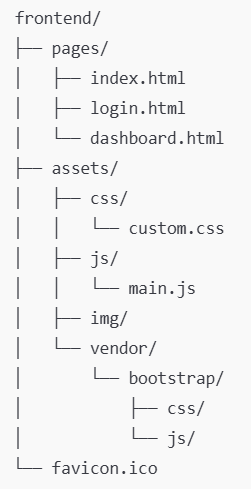

# Front-end - Documentação Geral

## Tecnologias

O front-end utiliza HTML 5, CSS 3, Javascript e Bootstrap 5.

## Organização

O front-end está organizado com a seguinte hierarquia de pastas:

* pages/ → páginas HTML

* assets/css/ → estilos próprios (não editar Bootstrap)

* assets/js/ → scripts JS (fetch para API, validações etc)

* assets/img/ → imagens do sistema

* vendor/bootstrap/ → arquivos do Bootstrap

Observação: os arquivos listados são apenas exemplos e não necessariamente existem nas respectivas pastas.