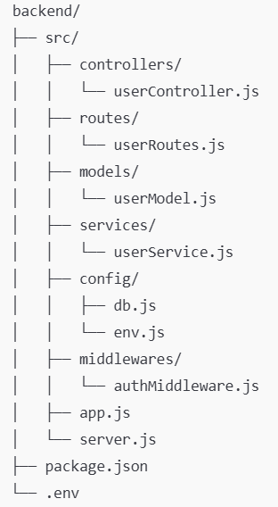

# Back-end - Documentação Geral

## Tecnologias

O back-end utiliza Node.js, Express e MySQL.

## Organização

O back-end está organizado com a seguinte hierarquia de pastas:

* controllers/ → recebem a requisição e retornam resposta

* routes/ → definem as rotas da API

* models/ → comunicação com o MySQL

* services/ → regras de negócio

* config/db.js → conexão com MySQL

* middlewares/ → autenticação, validações

* src/app.js → configuração do Express

* src/server.js → inicialização do servidor

Observação: os arquivos listados, com exceção dos arquivos config/db.js, config/env.js, src/app.js, src/server.js, /package.json e /.env, ser são apenas exemplos e não necessariamente existem nas respectivas pastas.