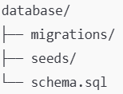

# Banco de Dados - Documentação Geral

## Tecnologias

O banco de dados utiliza MySQL.

## Organização

O banco de dados está organizado com a seguinte hierarquia de pastas:

* schema.sql → criação das tabelas

* migrations/ → alterações versionadas

* seeds/ → dados iniciais